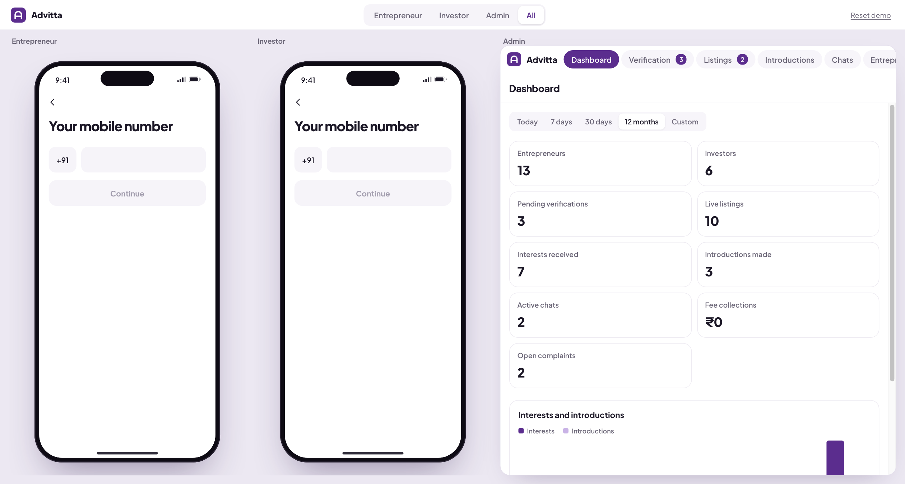
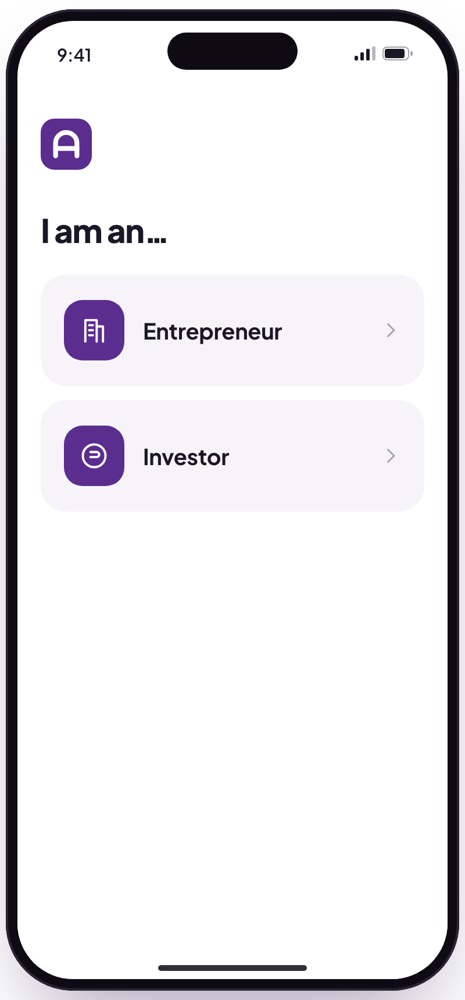
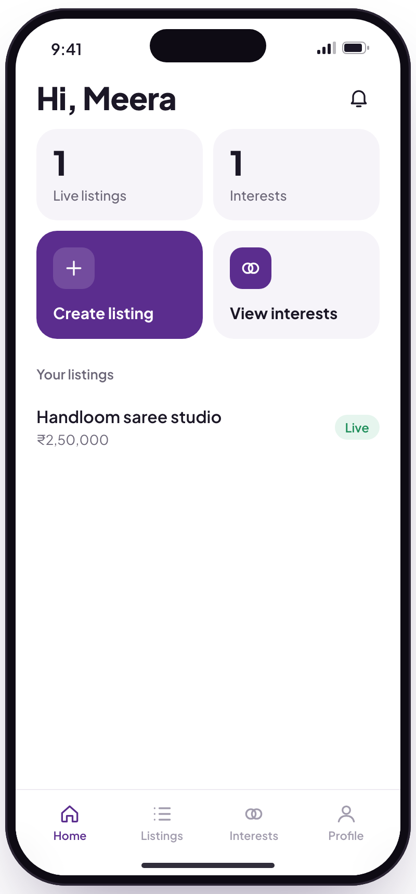
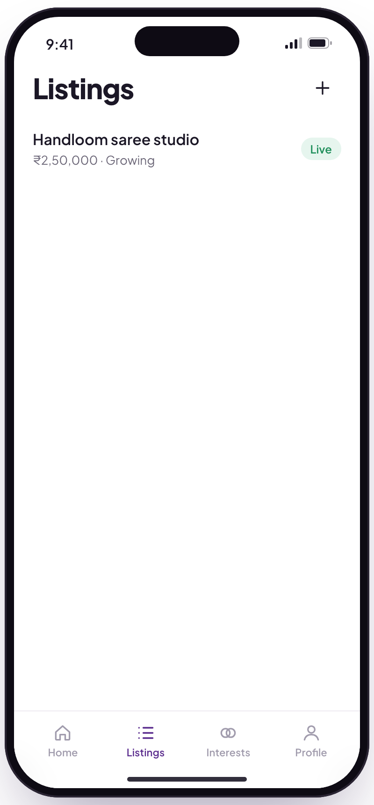
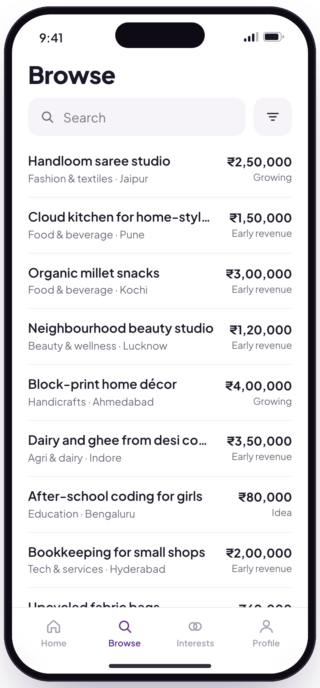
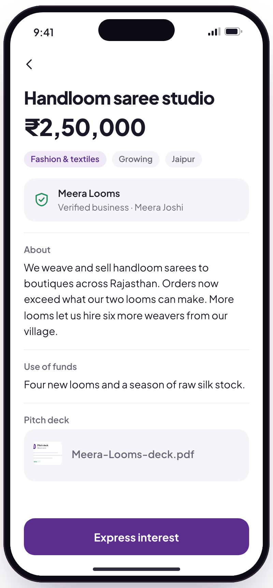
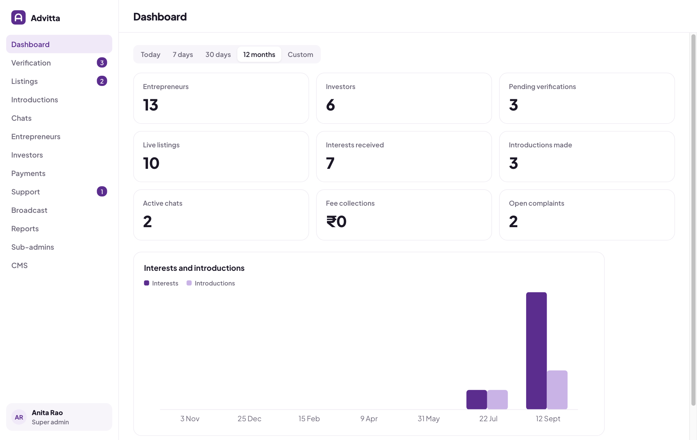
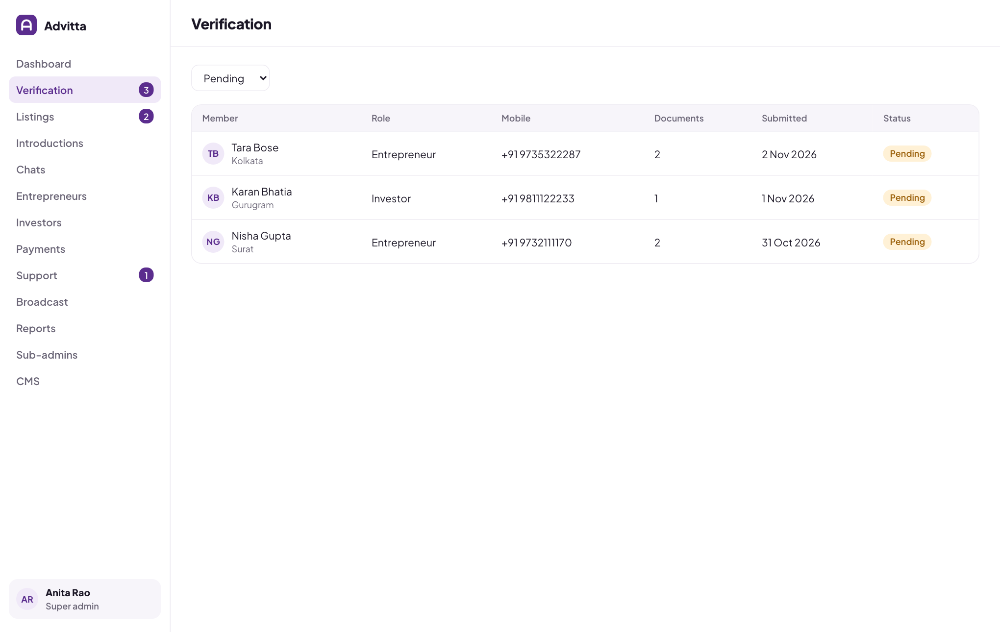

<p align="center"></p>

<h1 align="center">Advitta</h1>

<p align="center">Click-through MVP demo: a mobile app for women entrepreneurs and investors, plus the admin web panel.<br>No build step. No dependencies.</p>



## Try it

```bash
npm start
```

Open <http://localhost:3000>.

| Path | Opens |
| --- | --- |
| `/` | Demo hub: Entrepreneur, Investor and Admin side by side |
| `/app` | Phone app only |
| `/admin` | Admin panel only |

On a phone, all three open full screen. On a desktop, the app sits inside a phone frame.

### Logins

| Where | Login |
| --- | --- |
| Phone app | Any 10-digit number, any 4-digit code |
| Admin (super admin) | `admin@advitta.in` / `Admin@123` |
| Admin (staff, limited modules) | `staff@advitta.in` / `Staff@123` |

## What is inside

**Phone app**

<p>





</p>

- Entrepreneur: sign up, upload documents, get verified, publish listings (₹50k to ₹5L), track interests, chat after introduction.
- Investor: sign up, get verified, browse and filter listings, express interest, chat after introduction.
- Uploaded images and documents preview in the app and in the admin panel.
- Fees (membership, listing, connection) switch on from the admin panel.

**Admin panel**



Dashboard, Verification, Listings, Introductions, Chats, Entrepreneurs, Investors, Payments, Support, Broadcast, Reports (CSV), Sub-admins with per-module access, and CMS. Tables turn into cards on phones.



## How it works

- Everything the demo shows is stored in the browser (`localStorage`, key `advitta.demo.v2`). The phone apps and the admin panel share it, so an admin approval appears in the app instantly.
- Live sync works inside one browser. Use the hub's **All** view to show the whole flow.
- **Reset demo** restores the sample data.
- No money moves on the platform. Advitta staff introduce investors to entrepreneurs.

## Deploy on Render

1. Push this repo to GitHub.
2. In Render: **New → Web Service**, pick the repo.
3. Runtime `Node`, build command `echo "no build"`, start command `npm start`, plan Free.

`render.yaml` has the same settings, so **New → Blueprint** also works. The free plan sleeps when idle, so open the link once before sharing it.

## Project

```
server.js        static server with route aliases
public/
  hub.html       demo hub
  index.html     phone app shell      app.js, styles.css
  admin.html     admin panel          admin.js, admin.css
  db.js          shared data and seed
docs/            screenshots
```
